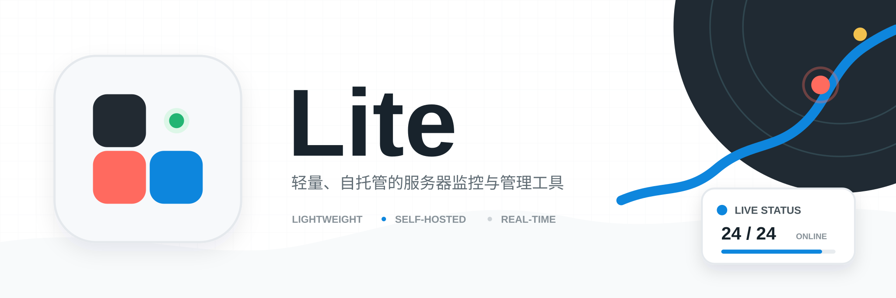
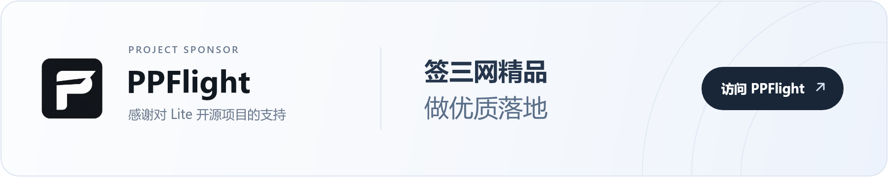

[](https://github.com/nuomiiiii/lite/releases)
[](https://github.com/nuomiiiii/lite/pkgs/container/lite)
[](https://t.me/komari_lite)
[](LICENSE)

Lite 是一款轻量、自托管的服务器监控与运维管理工具。服务端提供 Web 管理界面，Agent 负责采集节点状态、执行延迟与回程线路探测，并在管理员授权后提供远程终端、文件管理和任务执行能力。通过 MCP 代理，还可以让 AI 客户端在授权有效期内管理选定的服务器。

本项目基于 [komari-monitor/komari](https://github.com/komari-monitor/komari) 持续开发，重点改善低配置主控上的数据库占用、历史查询和维护负载，同时提供流量管理、成本中心、备份迁移、接入安全与适配电脑和手机的管理界面。

**当前正式版：Lite [`2.3.10`](https://github.com/nuomiiiii/Lite/releases/tag/2.3.10) · 配套 Agent [`2.3.10.1`](https://github.com/nuomiiiii/Lite-agent/releases/tag/2.3.10.1) · 默认主题 [`1.3.0`](https://github.com/nuomiiiii/Lite-theme/releases/tag/v1.3.0)**

[使用手册](https://nuomiiiii.github.io/Lite-document/) · [快速开始](#快速开始) · [功能概览](#功能概览) · [升级说明](#从旧版本升级) · [Agent](#agent-与远程管理) · [MCP 代理](#mcp-代理与-ai-授权) · [完整更新日志](https://github.com/nuomiiiii/lite/releases)

> [!WARNING]
> Lite 只能部署在你拥有或已获得授权管理的设备上。请勿将其用于未经授权的访问、持久化、命令执行或其他滥用行为。管理员应启用 HTTPS 与双因素认证，并妥善保护 Agent Token 和备份文件。

## 赞助商

<a href="https://www.ppflight.com/?aff=1032">
  <picture>
    <source media="(max-width: 600px)" srcset="docs/assets/sponsors/ppflight-banner-mobile.png" />
    
  </picture>
</a>

## 2.3.10 稳定版能力摘要

- **告警中心**：汇总当前离线、负载、延迟监测和回程线路告警，可在此设置静默（24 小时 / 3 天 / 7 天 / 永久 / 解除）。静默只暂停告警通知，恢复通知仍会发送。
- **主题更新**：已安装且能找到来源的主题可以一键更新或自动更新。通用设置可填 GitHub 代理，主题下载、更新和节点部署指令都能用。
- **仪表盘**：可设置时区，默认 UTC+8（北京时间）；今日流量、按日趋势和今日恢复按此时区切日。排行打开全部列表后可切换正序 / 倒序。打开服务器会记住上次选中的机器。「续费日历」按到期日汇总；同一天有多台时，点「我已续费」后弹框保持打开。每日流量明细里，点击服务器名称会进入用量统计。
- **定时任务**：可以按北京时间，在选定的服务器上定时远程执行命令，并保留每次输出。任务可以搜索、调整顺序，点进详情查看执行日志。
- **加载**：仪表盘时延排行和服务器列表在服务器较多时会更快打开。
- **MCP 授权**：批准页可以勾选长期授权，默认不勾选。勾选后，这条授权在撤销前一直有效；不勾选则按所选时长。有效授权可编辑服务器范围、备注和有效期，也可选择「全部服务器（含后续新增）」。单次 MCP 终端跟授权到期走，空闲不会结束。最长授权时长可以设到 72 小时。
- **远程终端**：单次最长 6 小时，空闲 30 分钟会结束。已打开的会话不再显示服务器标签。
- **通知**：一种告警可以同时发给多路，也可以都不发送。相同内容可在设定时间内合成一条，默认关闭。
- **延迟监测告警**：细分为「丢包告警」和「延迟异常告警」。延迟异常支持自适应基线和固定基线。
- **服务器到期时间**：可以指定时区，并精确到秒；账单到期可用「今」填入当前时间。原有到期日升级后记为北京时间当天 00:00:00。
- **成本中心**：服务器国旗跟随手选的国家/地区图标；没手选时仍用自动识别。
- **日志**：过长的 IPv6 会自动换行，不再盖住后面的类型和内容。
- **手机端远程终端**：复制、粘贴、Tab 旁有「Ctrl+C」，用来打断正在执行的命令。
- **回程线路**：可保存探测配置模板，应用到已有服务器，也可在新服务器加入时自动创建。公开大屏可展示当前回程线路名和疑似被墙。
- **内置主题**：Lite-Theme `1.3.0`。首页可按服务器设置探测任务，可显示回程线路名称，没有探测任务的卡片可隐藏探测窗口。手机端概览默认关闭。

## 功能概览

| 模块 | 现有能力 |
| --- | --- |
| 节点监控 | CPU、内存、磁盘、网络、负载、连接数、运行时间、在线状态与实时流量 |
| 节点管理 | 分组、备注、标签、国家/地区修正、分页排序、重置 Token、账单、价格、货币、流量额度和重置日，以及 Agent 配置上报、在线下发与结果确认 |
| 仪表盘配置 | 预制布局、模块开关与排序、卡片宽度、实时与历史独立刷新、时区（默认 UTC+8）、Top 5/10/15/20 排行（可切换正序/倒序）、近 30 天流量和每日服务器明细，以及按到期日汇总的续费日历 |
| 成本中心 | 日/月/年费用、资费版本、附加费用、剩余价值、到期提醒、多币种汇总与作废冲销 |
| 延迟监测 | IPv4/IPv6 目标探测、历史曲线、平均时延、延迟抖动、近 15 分钟丢包排行、任务排序和异常告警 |
| 回程线路 | 电信、移动、联通线路识别，切线与恢复判断、BGP 规则自动更新、监测记录与通知，以及需主动开启的 IP 疑似被墙实验功能 |
| 通知与报告 | 按告警类型选择渠道，可同时发给多路；相同内容可在设定时间内汇总成一条。告警中心汇总当前告警并可静默。另有离线通知、负载告警、延迟丢包告警、流量告警，以及日/周/月流量报告 |
| 远程管理 | 多会话 Web 终端、文件管理、命令剪贴板、远程任务执行和定时任务；单次最长 6 小时，空闲 30 分钟结束。需要同时开启站点和 Agent 本地开关，并完成管理员重新验证 |
| MCP 代理 | AI 客户端接入、按节点授权或全部服务器、可选长期授权、授权范围可编辑、命令与文件操作、交互终端、并发限制、操作记录及授权撤销 |
| 数据与存储 | SQLite 占用明细、运行诊断、历史分层、上游 1.3.1/1.4.x 数据迁移、WAL 维护、手动空间回收、完整备份恢复和仅配置导出 |
| 接入与安全 | 管理员登录、双因素认证、单点登录、会话管理、API 与 WebSocket Origin 校验、内置 HTTPS、反向代理和 Cloudflare Tunnel |
| 外观与多端 | 系统 UI 与公开主题独立、主题市场、一键更新与自动更新、GitHub 代理、预览缓存、多语言主题信息、节点与 Ping 任务选择器、最后一个主题保护；电脑端列表、手机端卡片，并适配简体中文、繁体中文、英文、日文 |
| 部署与更新 | systemd / OpenWrt procd 一键安装与受控回退、Docker、Windows/Linux 多架构二进制和在线更新校验 |

## 快速开始

### Linux 一键安装

复制一行即可下载并安装。适用于使用 systemd 的常见 Linux 发行版：

```sh
curl -fsSL https://raw.githubusercontent.com/nuomiiiii/lite/main/install-lite.sh -o install-lite.sh && sudo sh install-lite.sh
```

OpenWrt / iStoreOS 以 root 登录后（通常没有 bash、sudo 或 curl）：

```sh
wget -O install-lite.sh https://raw.githubusercontent.com/nuomiiiii/lite/main/install-lite.sh && sh install-lite.sh
```

安装脚本会按环境选择 systemd 或 procd；满足运行时检查与回退条件后，可使用后台“立即更新”。官方 Linux 包提供 `amd64`、`arm64`、`386`、`riscv64` 和 `loong64`，软路由也需匹配其中一种架构。安装完成后访问 `http://<服务器或路由器 IP>:27777`。正式环境可在后台启用内置 HTTPS，也可以使用反向代理或 Cloudflare Tunnel 接入。详细步骤见[Linux 脚本安装手册](https://nuomiiiii.github.io/Lite-document/install/linux)。

### Docker

```bash
mkdir -p ./data
docker run -d \
  --name lite \
  --restart unless-stopped \
  -p 27777:27777 \
  -v "$(pwd)/data:/app/data" \
  ghcr.io/nuomiiiii/lite:latest
```

固定使用当前正式版时，将镜像标签改为 `ghcr.io/nuomiiiii/lite:2.3.10`。

更新 Docker 部署前请先备份 `data` 目录，然后拉取新镜像并使用原来的端口和数据挂载重新创建容器：

```bash
docker pull ghcr.io/nuomiiiii/lite:latest
docker rm -f lite
docker run -d \
  --name lite \
  --restart unless-stopped \
  -p 27777:27777 \
  -v "$(pwd)/data:/app/data" \
  ghcr.io/nuomiiiii/lite:latest
```

不要在未确认备份的情况下删除宿主机数据目录。

### 二进制文件

从 [Releases](https://github.com/nuomiiiii/lite/releases) 下载与系统架构匹配的文件。正式版提供 Linux `386`、`amd64`、`arm64`、`loong64`、`riscv64`，以及 Windows `386`、`amd64`、`arm64` 构建。

```bash
chmod +x Lite-linux-amd64
./Lite-linux-amd64 server -l 0.0.0.0:27777
```

默认数据目录为程序工作目录下的 `data`。

## Agent 与远程管理

Lite `2.3.10` 推荐配套 [Lite-agent `2.3.10.1`](https://github.com/nuomiiiii/Lite-agent/releases/tag/2.3.10.1)。先在后台添加节点，再打开该节点的“节点配置 → 部署指令”，复制完整命令到目标服务器执行。自动发现注册已下线，新安装和 Docker 重建均使用具体节点的部署指令。

远程终端、文件管理和远程执行需要同时开启 Lite“系统设置 → 通用 → 允许远程管理”与 Agent 本地 `--enable-remote-control`，新安装默认关闭。进入远程功能时，已启用通行密钥的账号可用通行密钥验证；已启用两步验证但未使用通行密钥时输入当前验证码；未启用时重新输入管理员密码。浏览器远程终端单次最长 6 小时，空闲 30 分钟会结束。

在线配置支持采集间隔、流量重置日、网卡、挂载点、内存缓存计入方式与 GPU 监控的保存、下发和结果确认。远程控制开关等安装选项需要更新节点本地启动参数并重启或重新安装 Agent。安装、日志、更新和卸载步骤见[Agent 安装与维护](https://nuomiiiii.github.io/Lite-document/install/agent)，操作方式见[远程终端与文件](https://nuomiiiii.github.io/Lite-document/remote/terminal)。

### MCP 代理与 AI 授权

1. 使用配套 Lite-agent，并开启上述站点和 Agent 远程控制开关，再开启“系统设置 → 通用 → 启用 MCP 代理”。
2. 进入“远程管理 → MCP 代理”，复制服务地址，例如 `https://monitor.example.com/mcp`，添加到支持浏览器授权的 AI 客户端。
3. 客户端发起连接后，在 Lite 中选择允许管理的服务器、授权时长或长期授权，以及可选备注，输入管理员密码、两步验证码或通行密钥，点击“授权并连接”。
4. 回到 AI 客户端执行操作；在 Lite 的“授权详情”和“操作记录”中查看状态、导出记录或撤销授权。

MCP 默认关闭。批准页可以勾选长期授权，默认不勾选。勾选后，这条授权在撤销前一直有效，AI 以 Agent 运行账户的权限执行命令、使用终端和读写文件，Lite 不会逐次确认。到期或撤销会结束相关访问，已完成的修改不会自动回滚。详细配置与排查见[MCP 代理与 AI 授权手册](https://nuomiiiii.github.io/Lite-document/remote/mcp)。

## 数据库与升级说明

### SQLite 指标存储

SQLite 指标库使用紧凑的无损编码和分层保留。压缩不会额外改变已采集指标的数值精度，详细指标和历史汇总继续遵循后台设置的保留周期；流量报告所需的累计值由独立精确账本保存。

数据库缓存、查询并发和后台维护批次会根据主控资源自动调整。已经形成的历史数据堆积会从保存位置继续处理，每批成功后才清理对应旧数据；失败时保留原数据并在后续重试。

这套迁移只适用于 SQLite 指标存储。外置 MySQL 或 PostgreSQL 不会进入 SQLite 指标库迁移，也不会显示对应进度。

### 从旧版本升级

> [!IMPORTANT]
> 从旧数据库布局升级时可能需要迁移。升级前请备份完整 `data` 目录；首次启动时不要中断迁移，并等待后台迁移页面明确显示完成。

1. 停止旧 Lite，备份程序和完整 `data` 目录。
2. 更新程序或容器，并保持原有 `data` 挂载不变。
3. 打开管理页面查看迁移进度，确认节点连接、历史曲线、账单与远程功能正常，并保留备份供回退。
4. SQLite 产生的空闲页会继续复用；如需立即把空间归还给磁盘，可在业务低峰期手动执行一次“回收空间”。

上游 `1.3.1`、`1.3.2`、`1.4.x` 以及本分支 `2.1.7` 至 `2.1.11` 的 SQLite 指标库会通过同一迁移页面转换为当前格式，原有数据保留周期不会被改回默认值。监控数据固定启用分层降采样，升级时会自动停用旧版低资源模式。

完整步骤与兼容范围见[更新与数据库迁移](https://nuomiiiii.github.io/Lite-document/install/update)。

## Linux 一键更新与回退

一键更新面向官方脚本安装、由 systemd 或 OpenWrt / iStoreOS procd 管理且满足运行时检查的 Linux 实例。更新程序会校验版本、构建标识、大小和 SHA-256，备份当前程序及完整 `data`，并在新版本启动或健康检查失败时尝试恢复旧程序和更新前数据。

Docker、Windows、不受支持的服务管理方式、外置指标数据库和不满足原子回退条件的目录布局不会启用该入口。更新前仍应保留完整备份；详细限制见 [Linux 一键更新与回退](docs/self-update.md)。

## 从源码构建

后端使用 Go `1.26.10`，前端构建推荐使用 Node.js `24`，与当前发布流程一致。

以下命令编译服务端；完整网页还需要准备后文所述的系统 UI 与主题资源。

```bash
git clone https://github.com/nuomiiiii/Lite.git
cd Lite
go build -o Lite
./Lite server -l 0.0.0.0:27777
```

正式构建会将 [Lite Web](https://github.com/nuomiiiii/Lite-web) 作为独立系统 UI 构建，并把产物放入 `web/public/systemUI/dist`；公开大屏主题则保存在独立的主题目录中。正式版本必须使用与 Lite 相同版本的 Lite Web 标签，可参考仓库内的 GitHub Actions 构建流程。

## 相关链接

- [版本发布与完整更新日志](https://github.com/nuomiiiii/lite/releases)
- [Lite 文档](https://nuomiiiii.github.io/Lite-document/)
- [Telegram 群组](https://t.me/komari_lite)
- [Lite Agent](https://github.com/nuomiiiii/Lite-agent)
- [Lite Web](https://github.com/nuomiiiii/Lite-web)
- [Lite-Theme](https://github.com/nuomiiiii/Lite-theme)
- [上游 Komari](https://github.com/komari-monitor/komari)

## 致谢

感谢上游维护者、Agent 与主题贡献者，以及持续提供测试和反馈的社区用户。本分支保留上游版权与 MIT 许可证。

## 许可证

[MIT License](LICENSE)
